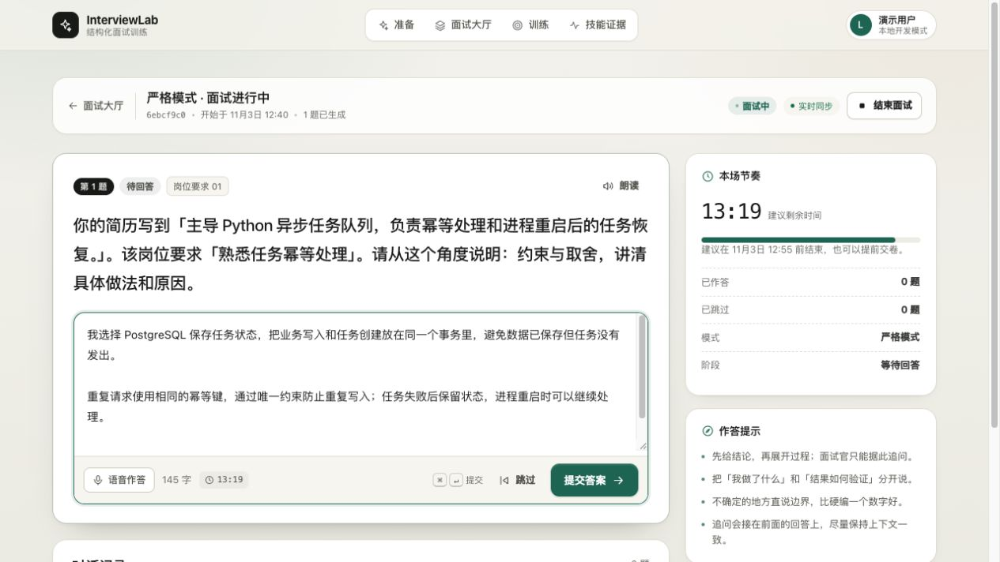
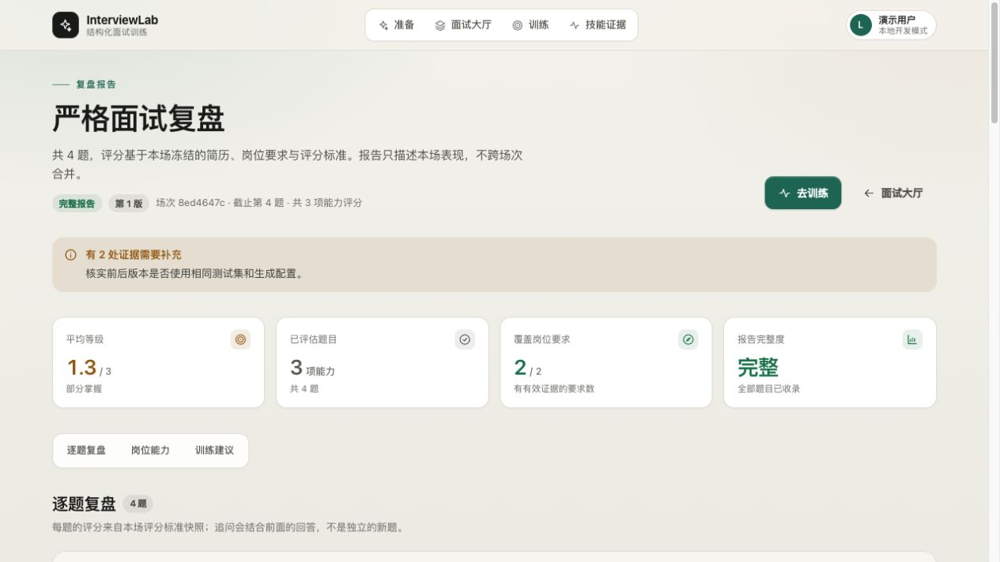

<div align="center">

# InterviewLab

### 不止练习回答，更练习把自己的经历讲清楚。

基于简历和目标岗位的 AI 模拟面试与专项训练系统

[界面预览](#界面预览) · [项目亮点](#项目亮点) · [使用流程](#使用流程) · [快速开始](#快速开始) · [常见问题](#常见问题)

</div>

---

你可能做过不少项目，却不一定能在面试时把它们讲清楚。

为什么选择这个方案？遇到问题时怎么定位？哪些工作是你亲自完成的？如果条件变了，你还会这样设计吗？

**InterviewLab 希望把这些问题，提前放到真正的面试之前。**

上传简历、提供目标岗位，开始一场围绕自身经历展开的模拟面试。回答之后，查看逐题复盘，再把没讲清楚的部分带入后续训练。

## 界面预览

以下为应用实际运行截图，使用独立演示环境与示例材料，不包含个人简历或本地历史记录。示例评分仅用于展示界面。

### 模拟面试

围绕项目经历作答，在同一页面查看题目、填写回答并掌握本场节奏。



### 复盘报告

面试结束后，查看本场反馈概览、岗位要求覆盖情况，再继续逐题复盘与专项训练。



## 项目亮点

### 围绕你的经历提问

不只练习一套固定题目。结合简历中的项目经历与岗位要求，让练习更贴近你真正可能面对的面试场景。

### 根据回答继续追问

不止于“问完一道就换下一道”。围绕你的回答补充细节，练习解释具体做法、选择理由和问题处理过程。

### 面试与复盘各有侧重

提问、评估和训练由不同角色协作完成。面试时专注表达，结束后再集中查看反馈，减少边答边看答案的干扰。

### 每一道题都能回看

查看问题、自己的回答和对应反馈，也能回到被引用的回答原文。不只得到一个结果，还能知道哪些内容已经讲清楚，哪些仍需补充。

### 从复盘走向练习

根据报告中的待训练项生成练习计划，通过不同角度的复测继续巩固，而不是把报告看完就结束。

### 按自己的节奏准备

支持面试时长设置、文字作答、题目朗读，以及不同层级的训练提示。看过提示的练习会与独立作答区分记录。

## 适合谁使用

- 正在准备 **AI 应用、Agent 开发、Python 后端**等方向的技术面试。
- 已有项目经历，希望练习把职责、实现过程和选择理由表达清楚。
- 希望用目标岗位要求检验自己的准备范围，而不只是刷通用题。
- 想把面试复盘转化为可继续完成的练习。

## 使用流程

1. **准备材料**：上传文本或可提取文字的 PDF 简历，填写目标岗位描述。
2. **确认内容**：检查解析后的材料，选择本场面试时长。
3. **开始面试**：逐题作答，回应围绕当前内容展开的追问。
4. **查看复盘**：回顾每道题的回答、反馈和待补充内容。
5. **继续训练**：生成练习计划，按需使用提示，再尝试独立完成变式复测。

> 建议使用真实、具体的项目经历。相比堆叠术语，把“做了什么、为什么这样做、怎样确认结果”讲清楚，更有助于准备面试。

## 快速开始

需要 Python 3.12+、Node.js 20+、pnpm、Docker，以及模型服务的 API Key。

### 1. 下载项目并安装依赖

```bash
git clone https://github.com/xunqingyao/InterviewLab.git
cd InterviewLab

python3 -m venv .venv
.venv/bin/python -m pip install -e ".[dev]"
make web-install
```

### 2. 配置模型

```bash
cp .env.example .env
```

编辑 `.env`，填写 `MODEL_API_KEY`，并确认模型地址和名称与你的服务商一致。已有配置时，请不要再次复制覆盖。

**真实密钥只放在本地 `.env`，不要提交到仓库。**

### 3. 启动服务

```bash
make db-up
make migrate
make seed
make run-api
```

另开终端，在项目根目录执行：

```bash
make run-web
```

打开 **http://127.0.0.1:5173**，即可开始使用。

默认启动已包含后台任务处理，不需要额外启动 Worker。更多配置与排障说明，见 [本地运行指南](SETUP.md)。

## 常见问题

### 支持扫描版 PDF 吗？

目前支持能够提取文字的数字 PDF。扫描图片型 PDF 建议先转为文本，或直接粘贴简历内容。解析后请检查材料是否完整、顺序是否正确。

### 面试时长是强制倒计时吗？

当前是建议时长。到时后仍允许完成当前回答，提交后进入收尾，不会在输入过程中突然丢弃答案。

### 为什么不一定能生成训练计划？

训练计划基于报告中的待训练项生成。如果评分仍在处理中，或没有待训练项，页面会给出相应提示。

### 可以只在本地运行吗？

可以。网页和数据库可以部署在自己的电脑上。不过，使用在线模型时，面试所需材料和回答会发送给配置的模型服务商。**本地部署不等于模型推理完全离线**，请先确认服务商的数据政策。

### 反馈可以作为招聘或能力认证结果吗？

不可以。InterviewLab 是练习和复盘工具，不预测录用结果。AI 反馈可能不准确，建议结合原始回答和自己的判断使用。

## 隐私与使用提醒

- 上传前，建议移除身份证号、住址等与练习无关的敏感信息。
- 不要上传未经授权的公司代码、商业资料或他人简历。
- `.env`、上传文件和本地运行数据默认不纳入 Git 提交。
- 公开部署前需要单独完成访问控制和安全配置，默认配置面向本地开发。

## 参与改进

欢迎通过 [Issues](https://github.com/xunqingyao/InterviewLab/issues) 反馈问题或提出建议。

如果遇到不合理的题目、追问或反馈，请尽量说明操作步骤、预期结果和实际表现。提供截图或日志前，请先移除密钥和个人信息。

---

<div align="center">

**让每一次练习，都能为下一次真实面试积累一点准备。**

</div>
